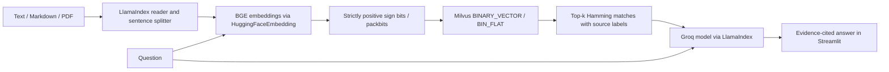

# Binary Quantized RAG

Load a document with LlamaIndex, generate BGE text embeddings, pack their signs
into binary vectors, retrieve them in Milvus with Hamming distance, and ask a
Groq-hosted model to answer with numbered evidence citations. A Streamlit app
connects these pieces without deploying any cloud resources.

One float32 dimension occupies 32 bits; its packed sign occupies one bit. This
reduces **vector payload** by 32× when the dimension is divisible by eight. Text,
metadata, index overhead, the embedding model and runtime memory remain extra.
Binary quantization loses information and can reduce retrieval quality. BIN_FLAT
is exact Hamming search, with linear scan cost; this project does not claim a
particular latency or demonstrate a 36-million-vector deployment.



## Code map

| File | Responsibility |
| --- | --- |
| `rag.py` | Chunk validation, sign packing, exact offline index, native Milvus schema/search, LlamaIndex document/model adapters, evidence prompt and Groq generation |
| `app.py` | Upload a document, build a fresh index, show payload size and evidence, generate an answer |
| `demo.py` | Deterministic fixture-vector search and prompt construction without network/model/key requirements |
| `test_rag.py` | Numeric, boundary and native adapter contract tests |
| `requirements.txt` | Native runtime dependencies |
| `requirements-test.txt` | Additional HTTP mocking dependency for native SDK tests |

## Run the mechanics check

Python 3.11+ is supported by the project; use a NumPy release compatible with your
Python version. Tested here on Python 3.13 with NumPy 2.5.4.

```powershell
python -m venv .venv
.venv\Scripts\Activate.ps1
python -m pip install -r requirements.txt -r requirements-test.txt
python demo.py
python -m unittest -v
```

The offline demo uses **explicit hand-written fixture vectors**, not a semantic
embedding model or an LLM. It prints distances 0 and 4 and payload sizes 96 and
3 bytes. Its `quality_evidence` flag is false. Tests require no network access,
provider key, pretrained model download, or running database.

## Run the native app

Start an accessible Milvus server compatible with PyMilvus 3.0.2 using its official installation guide.
Windows users should connect to a Docker/WSL/Linux server rather than rely on
Milvus Lite. This application creates a unique collection for each indexing
operation and never overwrites or deletes an existing collection. Collections
persist after the browser closes; manage them yourself in your Milvus instance.

```powershell
$env:MILVUS_URI = "http://localhost:19530"
$env:MILVUS_TOKEN = "" # Set only if your server requires authentication.
$env:GROQ_API_KEY = "your-key"
$env:GROQ_MODEL = "moonshotai/kimi-k2-instruct"
streamlit run app.py
```

The first native run downloads `BAAI/bge-large-en-v1.5`; it may require substantial
disk and memory. Remote model code is disabled. Change the model argument in
`NativePipeline` only to a compatible model whose output dimension is divisible
by eight. The reader supports text PDFs, not OCR for scanned PDFs. Splitting uses
a simple whitespace token budget; it is not a model-token limit guarantee.
The embedding adapter truncates inputs at 512 model tokens.

Keep the same embedding model for document and query encoding. Groq models can
change availability: set `GROQ_MODEL` to an accessible compatible model if needed.
Retrieved text and your question are sent to Groq only when you select
**Retrieve and answer**. Keys stay in environment variables and are never stored
in the database. The answer is a model output; inspect the displayed evidence.

Milvus client/server compatibility, native server search, pretrained BGE retrieval quality, actual Groq
generation, large-corpus latency and the browser interaction require your
configured services; offline tests do not establish those results.

## References

- [Original open-source application](https://github.com/patchy631/ai-engineering-hub/tree/042aeb5067384981eeba6a07fa882f436bb1660d/fastest-rag-milvus-groq)
- [Milvus binary vectors](https://milvus.io/docs/binary-vector.md)
- [Milvus BIN_FLAT](https://milvus.io/docs/bin-flat.md)
- [LlamaIndex SimpleDirectoryReader](https://developers.llamaindex.ai/python/framework/module_guides/loading/simpledirectoryreader/)
- [Milvus installation](https://milvus.io/docs/install_standalone-docker.md)
